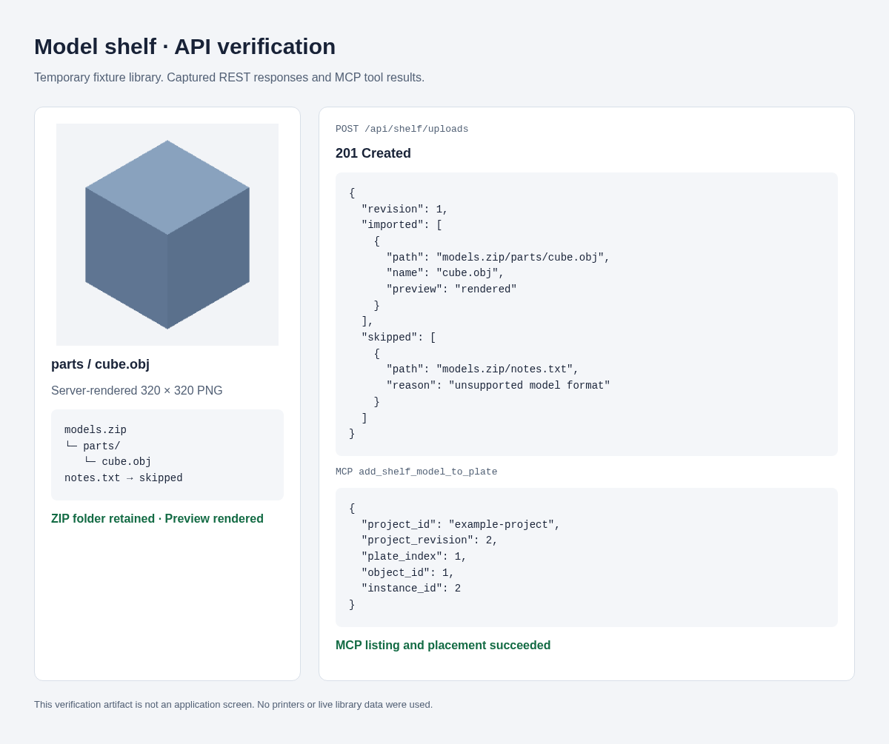

# Model shelf API

The shelf stores reusable models and folders separately from saved projects. This phase provides REST and MCP access. It adds no shelf screen.

## Access and revisions

All `/api/shelf` routes require the existing server access token or access cookie when server authentication is configured, including listings and thumbnails. MCP uses its existing origin and authentication checks.

`GET /api/shelf` returns immediate root children. Add `?folder=<folder-id>` for one folder or `?tree=1` for the complete tree. The response contains `revision`, `folders`, and `models`. Both collections are objects keyed by stable IDs. An empty parent string identifies the root.

```json
{
	"revision": 1,
	"folders": {
		"folder:example": {"id": "folder:example", "parent": "", "name": "Parts"}
	},
	"models": {
		"model:example": {
			"id": "model:example", "parent": "folder:example", "name": "bracket.stl",
			"sha256": "<64 lowercase hex characters>", "format": ".stl", "size": 184
		}
	}
}
```

Shelf writes require the revision from the latest listing. JSON mutations use `expectedRevision`. Uploads and deletes use `If-Match: "1"`, with the current revision in place of `1`. Missing `If-Match` returns 428. An invalid header returns 400. A stale revision returns 409 with `code: "revision_conflict"` and the current revision. A successful mutation advances the shelf revision once. Listings also return that revision as an ETag.

## Routes

| Method and path | Input and result |
| --- | --- |
| `GET /api/shelf` | Immediate folder children or the whole tree. |
| `POST /api/shelf/uploads?folder=<id>` | Multipart model files or ZIP archives. Requires `If-Match`. Omit `folder` for the root. Returns 201 with an import report. |
| `POST /api/shelf/folders` | JSON `expectedRevision`, `name`, and optional `parent`. Returns the created folder and revision. |
| `PATCH /api/shelf/folders/{id}` | JSON `expectedRevision` and `name`, `parent`, or both. |
| `PATCH /api/shelf/models/{id}` | JSON `expectedRevision` and `name`, `parent`, or both. Renaming preserves the original content format. |
| `DELETE /api/shelf/folders/{id}` | Requires `If-Match`. A populated folder also requires `?recursive=true`. |
| `DELETE /api/shelf/models/{id}` | Requires `If-Match`. Removes the shelf entry. |
| `GET /api/shelf/models/{id}/thumbnail.png` | Cached 320 by 320 PNG on a neutral background. Supports ETag revalidation. |
| `POST /api/shelf/models/{id}/add-to-plate` | Adds geometry to a saved project through its normal save transaction. |

Folder and model names share a case-insensitive sibling namespace. Names must be safe basenames of at most 240 UTF-8 bytes. Moves preserve IDs. Folder cycles and paths deeper than 32 folders are rejected. Rename and move collisions return 409. Upload collisions append a number before the extension, such as `bracket (2).stl`. Matching upload folders merge with existing folders. A folder that collides with a model gets a numbered name.

## Uploads and ZIP archives

Supported model extensions are STL, OBJ, 3MF, STEP, and STP, without regard to case. Multipart part names are unrestricted. Each part must have a safe filename. ZIP entry paths retain their folders, including explicit empty folders. The archive filename does not add another folder.

The response contains the following fields.

| Field | Contents |
| --- | --- |
| `revision` | Shelf revision after the import. |
| `imported` | Items with their archive path, saved `model`, and `preview` value of `rendered` or `placeholder`. |
| `skipped` | Unsupported files with their path and reason. Nested ZIP files are skipped. |
| `folders` | Folders created by the import. |

ZIP entries cannot use absolute paths, drive prefixes, backslashes, empty segments, `.` or `..`. Symlinks and special files are rejected, including unsupported files. Files are streamed with actual byte limits and CRC validation. An unsafe archive or invalid STL, OBJ, or 3MF mesh rejects the entire import. No partial shelf metadata is saved.

| Limit | Value |
| --- | --- |
| Multipart request | The smaller of the configured server upload limit and 512 MiB, including multipart framing. |
| One expanded file | The smaller of the configured server upload limit and 128 MiB. |
| Total expanded bytes | 512 MiB, including skipped files. |
| ZIP entries | 2,048 across the import. |
| Expanded tree | 2,048 model entries and distinct explicit or implicit folder paths per import. |
| ZIP central directory | 4 MiB, checked before parsing entries. |
| Decompression ratio | At most 200 expanded bytes per compressed byte, per entry. |
| Folder depth | 32. |
| Parsed geometry | At most 1,000,000 expanded triangles and coordinates within 1,000,000 mm. |

Limit failures return 413 for upload budgets. Invalid paths, archives, and supported mesh contents return 400. A model rejected by the geometry parser returns `model_invalid`.

## Add a model to a plate

The request requires the current shelf and project revisions, a stable operation ID, and the existing workspace editing session in `X-Orca-Session`.

```json
{
	"projectId": "saved-project",
	"plateIndex": 1,
	"expectedProjectRevision": 7,
	"expectedRevision": 1,
	"operationId": "add-bracket-001",
	"x": 50,
	"y": 50
}
```

Plate indexes are one-based. Supply both coordinates or omit both to use the saved printer's bed center. If that center is unavailable, explicit coordinates are required. Insertion does not arrange neighboring objects or guarantee that the model fits the bed. Existing slicing validation remains responsible for printable bounds.

The model becomes one geometry-only object with one instance and extruder 1. The source is a canonical STL asset with centered X and Y coordinates and its minimum Z at zero. 3MF build transforms, components, and units are applied. Source project settings, colors, painting, separate volume identities, and original plate layout are not imported. The shelf retains the original bytes.

The response includes `project_id`, `project_revision`, `plate_index`, `object_id`, `instance_id`, `source`, `sha256`, `revision`, and `operationId`. The project version history records the addition. Retrying the same operation ID and exact request replays the saved result. Reusing that ID for another request returns a conflict.

Missing, archived, or locked targets and conflicting project revisions or leases are rejected. A source snapshot is acquired under the shelf revision before parsing. Deleting that shelf entry afterward does not invalidate an insertion already processing its private source snapshot. Concurrent project changes are checked again at the final save.

## Thumbnails and STEP support

A bounded Go software renderer reads STL, OBJ, and 3MF geometry. Thumbnails are generated during upload, cached by the source SHA-256 and stored format, and regenerated on a cache miss. Large previews sample triangles to bound rendering work. Valid geometry with no visible pixels in the fixed view receives a placeholder preview and remains available for insertion.

STEP uses the configured headless engine's geometry-only `--export-3mf-generic` conversion, with one concurrent conversion and a 25-second timeout. No slice job or printer action is created. If conversion is unavailable or fails, the original STEP remains on the shelf with a placeholder preview. Adding it to a plate returns 422 until conversion succeeds. Thumbnails do not retry a cached placeholder until its cached PNG is removed.

## Persistence and collection

The library envelope has an optional `shelf` field. Existing profile document schemas and revisions are unchanged. An old library without this field loads as an empty shelf at revision zero. Shelf writes atomically replace the envelope after syncing referenced blobs. Profile saves preserve shelf metadata.

The shelf reuses the existing SHA-256 blob store. Duplicate content shares bytes. Eviction skips shelf references and content-addressed durable workspace assets. Only evictable bytes count toward the upload cache budget. Unreferenced blobs become eligible for the existing cache eviction policy. Shelf deletion does not immediately force collection below that budget. Existing project assets and retained history keep their current lifecycle and are not collected by shelf deletion. Thumbnail cache files are retained.

The existing developer reset clears the shelf with the rest of the library. Older application binaries do not know the new envelope field and can discard it when saving. Keep backups before a downgrade.

## MCP tools

| Tool | Arguments and behavior |
| --- | --- |
| `list_shelf` | Omitting `folder_id` returns the whole tree. An empty `folder_id` lists the root. |
| `upload_shelf_model` | `name`, standard base64 `data`, `expected_revision`, and optional `folder_id`. Accepts a model or ZIP and returns the REST import report. |
| `add_shelf_model_to_plate` | `model_id`, `project_id`, `plate_index`, `expected_revision`, `expected_project_revision`, `operation_id`, optional `x` and `y`, and optional editor `session`. |
| `prepare_shelf_delete` | `id`, `kind` of `model` or `folder`, `expected_revision`, and optional `recursive`. Returns the exact affected items, expiry, token, and digest. |
| `confirm_shelf_delete` | Exact `token`, `digest`, and `human_approved: true` after approval of the full prepared summary. |

MCP placement respects an existing browser editing lease. It uses the supplied editor session when present. Otherwise it uses its own MCP session without claiming a browser lease.

Delete confirmation tokens are session-bound, short-lived, and single-use for the owning session. A failed confirmation consumes the token. A caller in another session cannot consume it. The shelf revision is checked again when deletion commits. A client advertising elicitation must also accept form approval. No direct unconfirmed MCP delete tool is exposed.

## Verification

From `server`, run `go vet -mod=vendor ./...` and `go test -mod=vendor -count=1 ./...`. Shelf tests use temporary libraries, assets, ZIP fixtures, and MCP transports. They cover migration, folder retention, upload limits, unsafe archives, thumbnails, revisions, plate insertion, retention, and deletion confirmation.


